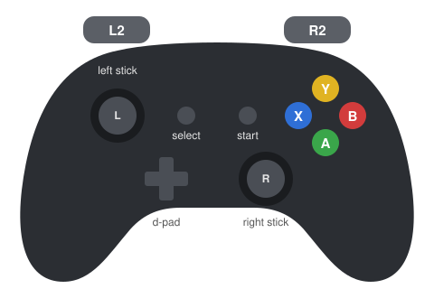

# **[CoRL 2026] RPL: Learning Robust Humanoid Perceptive Locomotion on Challenging Terrains**

<p align="center">
  Yuanhang Zhang, Younggyo Seo, Juyue Chen, Yifu Yuan, Koushil Sreenath,
  Pieter Abbeel<sup>†</sup>, Carmelo Sferrazza<sup>†</sup>, Karen Liu<sup>†</sup>, Rocky Duan<sup>†</sup>, Guanya Shi<sup>†</sup>
</p>

<p align="center">
  <strong>
    <a href="https://rpl-humanoid.github.io/">Project Website</a> |
    <a href="https://arxiv.org/abs/2602.03002">Paper</a> |
    <a href="https://youtu.be/HLWY-KYt4gk">Video</a>
  </strong>
</p>


> [!NOTE]
> **Research release only.** For potential issues and future support, please open an issue here or directly contact Yuanhang Zhang (yuanhang0610@gmail.com).
> Any integration of RPL features into [Holosoma](https://github.com/amazon-far/holosoma) mainline is a separate effort and will not be reflected here. We use IsaacGym as the training backend since IsaacSim is not fully supported yet (force perturbation not implemented in IsaacSim API).

Code for RPL - per-terrain experts RL training, multi-depth distillation, and sim2sim, built on [Holosoma](https://github.com/amazon-far/holosoma).

Capabilities:

- **Bidirectional Multi-Terrain Locomotion** - walks forward and backward across stairs, stepping stones, and slopes.
- **Whole-Body Teleoperation** - tracks commanded base velocity and end-effector pose, with base height and torso orientation adjustable during stance.
- **Force-Adaptive Payload Carrying** - compensates for unknown external forces at the end effectors.

## Repo layout

| Path | What it holds |
| --- | --- |
| [`thirdparty/holosoma/`](https://github.com/amazon-far/holosoma) | Holosoma core (git submodule): warp ray-cast multi-depth rendering, PPO-MA, DAgger-MA, ViT / CNN modules, terrains |
| `rpl_training/` | Everything outside Holosoma core: loco-manipulation env, manager terms, presets, launchers, tests |
| `rpl_training/data/` | ACCAD upper-body motion clips and the four teachers (`models/`) |
| `rpl_sim2sim/` | Sim2sim: MuJoCo environment (sim side), the depth student for `holosoma_inference` (policy side), reference student exports |

## Setup

Linux with NVIDIA GPUs.

```bash
git clone --recurse-submodules https://github.com/amazon-far/RPL.git
cd RPL
```

The [sim2sim demo](#sim2sim-mujoco) and [training](#training) each install their own conda envs.

## Sim2sim (MuJoCo)

https://github.com/user-attachments/assets/e0c3e96a-239f-4308-b16d-7e270d708463

Runs the depth student in the MuJoCo sim2sim environment in
`rpl_sim2sim/` ([video](assets/rpl_sim2sim.mp4)). The sim and the policy run
as two processes communicating over Unitree `sdk2py` (DDS), with depth images passed through shared memory.

### 1. Install

```bash
bash rpl_sim2sim/setup_env.sh
```

This builds two conda envs under `~/.holosoma_deps/miniconda3` (override with `CONDA_ROOT`):

| Env | Role | Override |
| --- | --- | --- |
| `rplmujoco` | Sim: MuJoCo, depth renderer, Xbox pad, Unitree SDK bridge | `SIM_ENV` |
| `rplinference` | Policy: `holosoma_inference` + the RPL depth student | `POLICY_ENV` |

The script needs an existing conda at `CONDA_ROOT`. If you have none, run
`thirdparty/holosoma/scripts/setup_mujoco.sh` once first.

### 2. Launch

> [!TIP]
> We highly recommend an **Xbox** controller for sim2sim. Plug it into the host running `run_sim.sh`.
> The keyboard works, but it's harder to steer smoothly.

Start the sim first, then the policy, each in its own terminal:

```bash
# Terminal 1: sim (terrain course, Xbox pad on this host)
bash rpl_sim2sim/run_sim.sh

# Terminal 2: policy (shipped student)
bash rpl_sim2sim/run_policy.sh
```

| Goal | Command |
| --- | --- |
| Run your own student | `run_policy.sh --task.model-path /path/model_XXXXX.onnx` |
| Use the keyboard instead of an Xbox pad | `run_sim.sh --no-joystick` (see [Controls](#controls)) |

`run_sim.sh --help` and `run_policy.sh --help` list the rest.

### 3. Walk

1. Release the elastic band: press `9` in the MuJoCo window.
2. Start the policy right away: `start` on the pad (`]` on the keyboard).
3. Switch to walking: `R2` (`=`).
4. Drive with the sticks (`w/s/a/d`, `q/e`).

### Keyboard in one tmux session: reset, band and waypoint following

`run_sim2sim_tmux.sh` starts the sim and the keyboard policy in one tmux session (`rpl_sim2sim`) and adds
function keys, so everything is driven from the policy terminal without switching to the MuJoCo window:

```bash
bash rpl_sim2sim/run_sim2sim_tmux.sh                 # drive with the keyboard (w/s, q/e)
bash rpl_sim2sim/run_sim2sim_tmux.sh --waypoints     # velocity from the waypoint follower (F6)
bash rpl_sim2sim/run_sim2sim_tmux.sh --spawn 2.5 -2 1.893   # start elsewhere (default 0 -2 0.8)
tmux kill-session -t rpl_sim2sim                     # stop everything
```

It runs `run_sim.sh --no-joystick --spawn 0 -2 0.8` by default: on the floor 1.1 m in front of the stairs, facing
them (+x). The tmux window `policy` takes the keys; the window `sim` shows the sim log (`Ctrl-b n` switches).
Console logs go to `logs/sim2sim/console_{sim,policy,waypoints}.log`. Run it from a terminal on the desktop
(the MuJoCo window needs the display); if the session is detached, `tmux attach -t rpl_sim2sim:policy`.

| Key (policy terminal) | Action |
| --- | --- |
| `F9` | Release / attach the elastic band (same as `9` in the MuJoCo window) |
| `F5` | Reset the sim and put the robot back at the spawn point; the band stays as it is |
| `F6` | Start the waypoint follower (`--waypoints` only); its output opens in a pane below the policy |
| `F7` | Stop the waypoint follower; the policy gets zero velocity within 0.5 s |

The policy prints a line whenever its command changes, e.g. `CMD vx=+0.20 vy=+0.00 wz=-0.10 | walk | base_h=0.75`.

**Walk with the keyboard:** `F9`, then `]` (start) and `=` (walk), then `w/s` and `q/e`. After a fall: `o`, `F5`,
`F9` to hang the robot again, and start over.

**Waypoint following** (`--waypoints`): `F9`, `]`, `=`, then `F6`. `w/s/q/e` no longer drive the robot; `]`, `=`,
`o` still work. The sim sends the base pose over localhost UDP to `rpl_sim2sim/waypoint_follower.py`, which turns
toward the next waypoint and sends `(vx, 0, wz)` back to the policy (`RPL_VELOCITY_INPUT=udp`). Commands stay
inside the training command ranges: forward speed 0.3-0.5 m/s (never below the 0.2 m/s training deadband),
`vy` always 0 (lateral velocity was zeroed in training), `|wz|` <= 0.6 rad/s. A waypoint counts as reached
within 0.25 m, and an `F5` reset restarts the route.

| Route (`WAYPOINT_ARGS`) | Path on the terrain course |
| --- | --- |
| `--route loop` (default) | Stairs up, stepping stones, turn and cross the 0.45 m gap to the far right platform, the 0.25 m gap, ramp down, back to the start; then the same lap reversed, walking backward |
| `--route loop --return forward` | Same lap, but the robot turns around and walks the reversed lap forward |
| `--route full` | Each row out and back (stairs + stones, then ramp + gap), switching rows on the ground |
| `--route left` | Stairs and stepping stones only |
| `--waypoints X,Y[,DIR] ...` | Your own points; `DIR` -1 walks backward to that point |

Set the options before launching, e.g. `WAYPOINT_ARGS="--return forward" bash rpl_sim2sim/run_sim2sim_tmux.sh
--waypoints`. Segments across the 0.45 m gap run at 0.8 m/s: at 0.5 m/s the policy stepped in place at the
edge, at 0.8 m/s it crossed. `--v-max` (0.3-1.0) sets the speed of the other segments.

### Controls

**Policy, Xbox pad:**

<table>
<tr>
<td>

| Input | Action |
| --- | --- |
| `start` | Start the policy |
| `A` + `X` | Init pose |
| `R2` | Toggle stand / walk |
| Left stick | Forward speed |
| Right stick | Yaw |
| `L2` | Zero velocity |
| `B` + `Y` | Stop |
| `B` + d-pad up / down | Base height |
| `Y` / `select` + d-pad | Waist |
| `R1` + d-pad | Hands forward / back, apart / together |
| `X` + d-pad up / down | Hands up / down |

</td>
<td></td>
</tr>
</table>

<details>
<summary><b>Policy, keyboard</b> (instead of the Xbox pad)</summary>

Run `run_sim.sh --no-joystick` and
`run_policy.sh --task.velocity-input keyboard --task.state-input keyboard`:

| Key | Action |
| --- | --- |
| `]` | Start the policy |
| `i` | Init pose |
| `=` | Toggle stand / walk |
| `w` / `s` | Forward / backward velocity, ±0.1 m/s per press (below 0.2 m/s the policy stands: training deadband) |
| `a` / `d` | Lateral velocity (training zeroed the lateral command on every terrain, so the student never learned to follow it) |
| `q` / `e` | Turn left / right, ±0.1 rad/s per press |
| `z` | Zero velocity |
| `o` | Stop |

</details>

**MuJoCo window:**

| Key | Action |
| --- | --- |
| `9` | Release the elastic band |
| `7` / `8` | Band length |
| `3` - `6` | Move the band anchor |
| `R` | Toggle video recording (`logs/sim2sim/simulation.mp4`) |
| `Backspace` | Reset the sim (MuJoCo's own reset: back to the model's default pose, band unchanged) |
| `Esc` | Free camera (the viewer starts following the torso); `Ctrl` + right double-click a body to follow it again |
| `[` / `]` | Cycle cameras (`]` here switches away from the follow camera; `[` goes back) |

## Training

### Install

```bash
bash rpl_training/training_runs/setup_env.sh
```

This builds the IsaacGym conda env `hsgym`. Optional environment variables:

| Variable | Effect |
| --- | --- |
| `ENV_NAME` | Conda env name (default `hsgym`) |
| `HOLOSOMA_LOCAL_DIR` | Use another Holosoma checkout instead of `thirdparty/holosoma` |

The launchers log to W&B by default. Set `LOGGER=disabled` to keep logs local under `logs/`, or
`WANDB_PROJECT` / `WANDB_ENTITY` / `RUN_NAME` to pick the W&B destination. `NGPUS` sets the number of GPUs,
and extra arguments pass through to `rpl_training.train_agent`.

### 1. Train the RL experts
We recommend training the experts on 4 GPUs.
```bash
NGPUS=4 EXPERT=stones bash rpl_training/training_runs/run_expert.sh --training.name stones-expert
NGPUS=4 EXPERT=stairs bash rpl_training/training_runs/run_expert.sh --training.name stairs-expert
NGPUS=4 EXPERT=slopes bash rpl_training/training_runs/run_expert.sh --training.name slopes-expert
```

### 2. Distill the multi-depth student
We recommend training the student on 8 GPUs.
```bash
NGPUS=8 bash rpl_training/training_runs/run_distill.sh --training.name rpl-student
```

It loads the shipped teachers
by default. To distill your
own experts, pass either:

```bash
# A directory with the same per-terrain layout as rpl_training/data/models
--algo.config.ckpt-teacher DIR

# Or one W&B checkpoint per terrain (slopes, stairs_up, stairs_down, stepping_stones_columns)
--algo.config.ckpt-teacher-wandb.slopes wandb://ENTITY/PROJECT/RUN_ID/model_XXXXX.pt
```

Distillation runs export `model_XXXXX.onnx` next to each checkpoint for [sim2sim](#sim2sim-mujoco).


## Citation

```bibtex
@article{zhang2026rpl,
  title   = {RPL: Learning Robust Humanoid Perceptive Locomotion on Challenging Terrains},
  author  = {Zhang, Yuanhang and Seo, Younggyo and Chen, Juyue and Yuan, Yifu and Sreenath, Koushil and Abbeel, Pieter and Sferrazza, Carmelo and Liu, Karen and Duan, Rocky and Shi, Guanya},
  journal = {arXiv preprint arXiv:2602.03002},
  year    = {2026}
}
```

Related: [FALCON](https://lecar-lab.github.io/falcon-humanoid/)

## License

Apache-2.0, see [`LICENSE`](LICENSE).