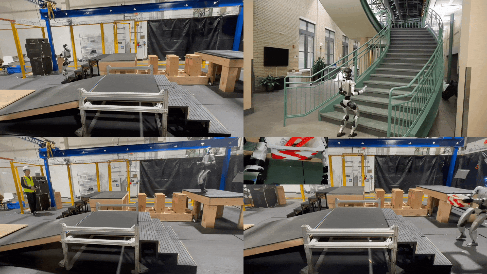

# **RPL: Learning Robust Humanoid Perceptive Locomotion on Challenging Terrains**

<p align="center">
  <strong>
    <a href="https://rpl-humanoid.github.io/">Project Website</a> |
    <a href="https://arxiv.org/abs/2602.03002">Paper</a> |
    <a href="https://youtu.be/HLWY-KYt4gk">Video</a>
  </strong>
</p>



Code for RPL (CoRL 2026): per-terrain RL experts and multi-depth DAgger distillation for the
Unitree G1 (29 DoF), built on [Holosoma](https://github.com/amazon-far/holosoma).

## Release status

This release includes RL expert training (stones, stairs, slopes), DAgger distillation of the
depth student, the four FALCON MoE teacher checkpoints, and a MuJoCo sim2sim environment with
reference student exports.

Training targets **IsaacGym** only. IsaacSim is not fully supported for RPL yet.

## Repo layout

| Path | What it holds |
| --- | --- |
| [`thirdparty/holosoma/`](https://github.com/amazon-far/holosoma) | Holosoma core (git submodule): warp ray-cast depth cameras, PPO-MA, DAgger-MA-MoE, MoE / ViT / CNN modules, FALCON terrains |
| `rpl_training/` | Everything outside Holosoma core: loco-manipulation env, manager terms, presets, launchers, tests |
| `rpl_training/data/` | FALCON ACCAD upper-body clips and the four FALCON MoE teachers (`models/moe_cnn/falcon_20251105`) |
| `rpl_sim2sim/` | Sim2sim: FAR-FALCON-Terrains' MuJoCo environment (sim side), the depth student for `holosoma_inference` (policy side), reference student exports |

Inside `rpl_training/`:

| Directory | What it holds |
| --- | --- |
| `envs/` | Loco-manipulation env and end-effector forces |
| `terms/` | Command, curriculum, observation, reward, and termination terms |
| `config_values/` | FALCON-parity presets (`exp:g1-29dof-rpl-*`) |
| `training_runs/` | Launchers: `setup_env.sh`, `run_expert.sh`, `run_distill.sh` |
| `tests/` | FALCON parity tests |

## Setup

Linux with an NVIDIA GPU.

```bash
git clone --recurse-submodules https://github.com/amazon-far/RPL.git
cd RPL
bash rpl_training/training_runs/setup_env.sh
```

This builds the IsaacGym conda env `hsgym`. Optional environment variables:

| Variable | Effect |
| --- | --- |
| `ENV_NAME` | Conda env name (default `hsgym`) |
| `HOLOSOMA_LOCAL_DIR` | Use another Holosoma checkout instead of `thirdparty/holosoma` |

## Training

The launchers log to W&B by default. Set `LOGGER=disabled` to keep logs local under `logs/`, or
`WANDB_PROJECT` / `WANDB_ENTITY` / `RUN_NAME` to pick the W&B destination. `NGPUS` sets the number of GPUs,
and extra arguments pass through to `rpl_training.train_agent`.

### 1. Train the RL experts

```bash
NGPUS=4 EXPERT=stones bash rpl_training/training_runs/run_expert.sh --training.name stones-expert
NGPUS=4 EXPERT=stairs bash rpl_training/training_runs/run_expert.sh --training.name stairs-expert
NGPUS=4 EXPERT=slopes bash rpl_training/training_runs/run_expert.sh --training.name slopes-expert
```

Presets `exp:g1-29dof-rpl-expert-{stones,stairs,slopes}` reproduce the run args of FALCON's final
expert stages (`falcon-29-terrains-experts-stones/lrlo8qpt`, `falcon-29-terrains-experts/h5d52hm0`,
`falcon-29-terrains-experts/b04ael3p`): terrain mix, reward weights / masks, friction, base COM, IMU
and heightmap noise, stair tread width, rough slopes, and 1 m tile spacing. They train from scratch
with the curricula on and no lower-body control delay, where FALCON fine-tuned from earlier stages.

Their base, `exp:g1-29dof-rpl-expert` (FALCON `+exp=falcon_hm_multi_terrain algo=ppo_ma_hm_cnn`),
takes the terrain mix on the CLI.

### 2. Distill the multi-depth student

```bash
NGPUS=8 bash rpl_training/training_runs/run_distill.sh --training.name rpl-student
```

Preset: `exp:g1-29dof-rpl-distill` (FALCON `+exp=falcon_hm_dagger_moe algo=dagger_ma_moe_hm_cnn_depth_vtr`),
on the experts' 1 m tile spacing. It loads the shipped FALCON teachers by default. To distill your
own experts, pass either:

```bash
# A directory with the same per-terrain layout as rpl_training/data/models/moe_cnn/falcon_20251105
--algo.config.ckpt-teacher DIR

# Or one W&B checkpoint per terrain (slopes, stairs_up, stairs_down, stepping_stones_columns)
--algo.config.ckpt-teacher-wandb.slopes wandb://ENTITY/PROJECT/RUN_ID/model_XXXXX.pt
```

Distillation runs export `model_XXXXX.onnx` next to each checkpoint for [sim2sim](#sim2sim-mujoco).

### Notes

- `--training.num-envs` is the total across GPUs. Presets default to FALCON's totals: experts
  4096 x 4 GPUs (the slopes expert 4096 total, as in FALCON), student 1024 x 8 GPUs.
- The presets are also registered as Holosoma entry points, so after `pip install -e .`,
  `python -m holosoma.train_agent exp:g1-29dof-rpl-expert ...` works too.

## Sim2sim (MuJoCo)

<video src="https://github.com/amazon-far/RPL/raw/main/assets/rpl_sim2sim.mp4" controls muted width="100%"></video>

Runs the depth student in FAR-FALCON-Terrains' own MuJoCo sim2sim environment, vendored in
`rpl_sim2sim/` ([video](assets/rpl_sim2sim.mp4)). The sim and the policy run
as two processes talking over Unitree `sdk2py` (DDS), with depth images passed through shared memory.

### 1. Install

```bash
bash rpl_sim2sim/setup_env.sh
```

This builds two conda envs under `~/.holosoma_deps/miniconda3` (override with `CONDA_ROOT`):

| Env | Role | Override |
| --- | --- | --- |
| `rplmujoco` | Sim: MuJoCo, depth renderer, Xbox pad, Unitree SDK bridge | `SIM_ENV` |
| `rplinference` | Policy: `holosoma_inference` + the RPL depth student | `POLICY_ENV` |

The script needs an existing conda at `CONDA_ROOT`. If you have none, run
`thirdparty/holosoma/scripts/setup_mujoco.sh` once first.

### 2. Launch

Start the sim first, then the policy, each in its own terminal:

```bash
# Terminal 1: sim (FALCON course, Xbox pad on this host)
bash rpl_sim2sim/run_sim.sh

# Terminal 2: policy (shipped student)
bash rpl_sim2sim/run_policy.sh
```

### 3. Walk

1. Release the elastic band: press `9` in the MuJoCo window.
2. Start the policy right away: `start` on the pad (`]` on the keyboard).
3. Switch to walking: `R2` (`=`).
4. Drive with the sticks (`w/s/a/d`, `q/e`).

### Controls

**Policy, Xbox pad** (FALCON's mapping):

| Input | Action |
| --- | --- |
| `start` | Start the policy |
| `A` + `X` | Init pose |
| `R2` | Toggle stand / walk |
| Left stick | Forward speed |
| Right stick | Yaw |
| `L2` | Zero velocity |
| `B` + `Y` | Stop |
| `B` + d-pad up / down | Base height |
| `Y` / `select` + d-pad | Waist |

**Policy, keyboard.** Run `run_sim.sh --no-joystick` and
`run_policy.sh --task.velocity-input keyboard --task.state-input keyboard`:

| Key | Action |
| --- | --- |
| `]` | Start the policy |
| `i` | Init pose |
| `=` | Toggle stand / walk |
| `w` / `s` / `a` / `d` | Linear velocity |
| `q` / `e` | Yaw |
| `o` | Stop |

**MuJoCo window:**

| Key | Action |
| --- | --- |
| `9` | Release the elastic band |
| `7` / `8` | Band length |
| `3` - `6` | Move the band anchor |
| `R` | Toggle video recording (`logs/sim2sim/simulation.mp4`) |

### Options

| Goal | Command |
| --- | --- |
| Run your own student | `run_policy.sh --task.model-path /path/model_XXXXX.onnx` |
| Spawn on the floor facing the stairs (default: the stair platform, as in FALCON) | `run_sim.sh --spawn 0 -2 0.8` |
| Use the keyboard instead of an Xbox pad | `run_sim.sh --no-joystick` (see [Controls](#controls)) |
| Run the sim in FALCON's own env (MuJoCo 3.9) | `CONDA_ROOT=~/.falcon_deps/miniconda3 SIM_ENV=fcreal bash rpl_sim2sim/run_sim.sh` |

`run_sim.sh --help` and `run_policy.sh --help` list the rest.

### What the sim reproduces

The sim side matches FALCON's `sim2real/run_sim.py task=loco_manip/loco_manip_cam robot=g1/g1_29dof
+obs=loco_manip/g1_29dof_depth task.USE_JOYSTICK=true` on `scene_g1_29dof_terrains_freebase_real.xml`,
with FALCON's MJCF and resolved config (`rpl_sim2sim/config/loco_manip_cam.yaml`):

- **Simulator loop:** PD on the latest `rt/lowcmd` every 5 ms, elastic band, passive viewer.
- **Depth image server:** front and back cameras at 240x135 (gymnasium renderer), cv2 bicubic resize to
  48x27, clipped to [0.1, 2] m and normalized to [-0.5, 0.5], 1-frame `depth_delay`, 10 Hz, shared memory
  `depth_img_shm`.

## Tests

```bash
python -m pytest rpl_training/tests   # FALCON parity: terms, terrains, modules, warp camera
python -m pytest rpl_sim2sim/tests    # sim side in rplmujoco, policy side in rplinference
```

## License

Apache-2.0, see [`LICENSE`](LICENSE).

## Citation

```bibtex
@article{zhang2026rpl,
  title   = {RPL: Learning Robust Humanoid Perceptive Locomotion on Challenging Terrains},
  author  = {Zhang, Yuanhang and Seo, Younggyo and Chen, Juyue and Yuan, Yifu and Sreenath, Koushil and Abbeel, Pieter and Sferrazza, Carmelo and Liu, Karen and Duan, Rocky and Shi, Guanya},
  journal = {arXiv preprint arXiv:2602.03002},
  year    = {2026}
}
```
